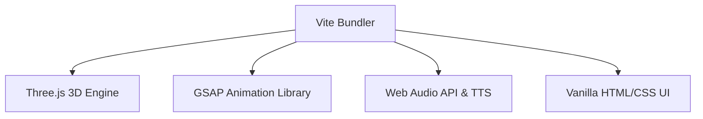

# Tech Stack Guide &mdash; The Biblical Experience Engine

This guide details the core technologies used to build the Biblical Experience Engine, explaining their implementation and role in bringing the scriptural narratives to life.

---

## 🛠️ Core Technology Stack

---

### 1. **Vite (Project Bundler & Dev Server)**
* **Role**: Serves as the ultra-fast development server and production bundler.
* **How it is used**:
  * Hot Module Replacement (HMR) allows instant feedback when tweaking Three.js coordinates or scene parameters.
  * Rollup configures the production bundle (`dist/`), outputting minified JS/CSS assets while optimizing library imports.

### 2. **Three.js (WebGL 3D Rendering)**
* **Role**: Renders the interactable 3D environments, low-poly terrains, elements, and characters.
* **How it is used**:
  * **Scenes**: `CreationScene`, `EdenScene`, `CainAbelScene`, `NoahScene`, and `BabelScene` inherit coordinate maps, particle loops, and per-frame update methods.
  * **Lighting**: DirectionalLights produce real-time soft shadow-mapping (`THREE.PCFSoftShadowMap`). HemisphereLights provide ambient outdoor fill.
  * **Terrain**: Dynamic vertex displacement on flat planes utilizing trigonometric equations (`Math.sin` / `Math.cos`) to generate procedural valleys, fields, and hills.
  * **Meshes**: Built using Three.js primitives (`SphereGeometry`, `CylinderGeometry`, `BoxGeometry`) and custom GLTF models styled with standard materials (`MeshStandardMaterial`) to achieve a cohesive, beautiful low-poly look. Features 5 distinct creature models (Lion, Lamb, Ox, Stag, Dove) with hovering golden beacon octahedrons and dynamic wander AI.
  * **Interactive Raycasting & 3D Sprite Billboards**: Uses `THREE.Raycaster` on mouse click and mobile touch pointer events to pick 3D creature meshes in the scene. Upon naming, dynamically renders high-resolution HTML Canvas rounded pill badges to `THREE.CanvasTexture` mounted onto `THREE.Sprite` billboards floating above the creatures with spring-back scale animations.
  * **Physics/Collisions**: Distance-based circle-to-circle collision bounding detection blocks player movement when colliding with scene obstacles (trees, altars, fences, ark structures) alongside proximity check zones (< 3.8m) for auto-recording creatures.

### 3. **GSAP (GreenSock Animation Platform)**
* **Role**: Coordinates complex cinematic sequences, camera pans, and mesh animations.
* **How it is used**:
  * Animates the camera's position and look-at targets smoothly during scripted story transitions.
  * Controls the scale/intensity of the sacrifice light pillars and the fade-in of Cain's mark.
  * Animates character orientations and skeletal transitions (e.g. Adam gesturing towards creatures, falling to knees, dropping arms, falling into deep sleep).
  * **Global Time Scaling**: Tied to `gsap.globalTimeline.timeScale(currentSpeed)`, ensuring cinematic transitions and animations synchronize seamlessly with 1x or 2x voiceover rates.

### 4. **Web Audio API (Procedural Environment Audio, Quest Chimes & Playback Scaling)**
* **Role**: Generates real-time, low-level atmospheric winds, environmental nature sounds, interactive quest completion chimes, and controls speech buffer rates.
* **How it is used**:
  * Procedurally synthesizes wind sounds by passing white noise through a dynamic `BiquadFilterNode` (lowpass).
  * Automatically shifts frequency cutoffs to simulate gusty wind speeds when scenes change.
  * **Sacred Creature Naming Chimes**: Synthesizes harmonic major triad chords (C5, E5, G5, C6) with dual sine/triangle oscillator overtone decay envelopes upon naming each creature.
  * **Real-Time Buffer Scaling**: Direct `playbackRate.setValueAtTime()` control on active `AudioBufferSourceNode` speech streams when toggling 2x playback speed on the fly.

### 5. **Web Speech API & Custom TTS Engine**
* **Role**: Reads scripture narrations and character dialogues using dynamic voice outputs.
* **How it is used**:
  * Uses the browser's native `window.speechSynthesis` interface alongside pre-generated neural TTS audio caches.
  * Configures distinct parameters (e.g., lower pitch and slower rate for God's voice, female voice for Eve, separate voices for Cain, Abel, Noah, and the Narrator).
  * **Dynamic Multiplier**: Modulates utterance rate (`utterance.rate = baseRate * speedMultiplier`), instantly accelerating or normalizing dialogue without distortion.
  * Integrates with HTML speech bubbles mapped dynamically to 2D screen projections of 3D characters.

### 6. **Responsive Touch & Mobile Navigation Architecture**
* **Role**: Delivers an ergonomic, native-app-quality mobile experience across phones and tablets.
* **How it is used**:
  * **Virtual Joystick**: Translates touch pointer vectors on `#joystick-base` into normalized directional input axes (`dirX`, `dirZ`) for character physics.
  * **Swipe Orbit Controls**: Single-touch drag gestures across the WebGL viewport modulate horizontal and vertical camera orbit angles while ignoring UI overlay interactions.
  * **Orientation Guidance & Layout Reflow**: Automatically detects mobile portrait orientation on load, presenting a gentle landscape recommendation with instant portrait fallback.
  * **State-Driven UI Lifecycle**: Clean separation between narrative states (subtitles, `Next ➔` dialogue button, speed toggle) and interactive gameplay states (action bar, virtual joystick, movement hints), hiding redundant controls to eliminate screen clutter.
  * **Zero-Overflow HUD**: Utilizes safe-area insets, flexbox wrapping, and dynamic label collapsing (`🏛️ Hub`, `🔄 Land`, `1x`/`2x`, `⏭ Skip`) to guarantee zero horizontal clipping on screens down to 320px.
